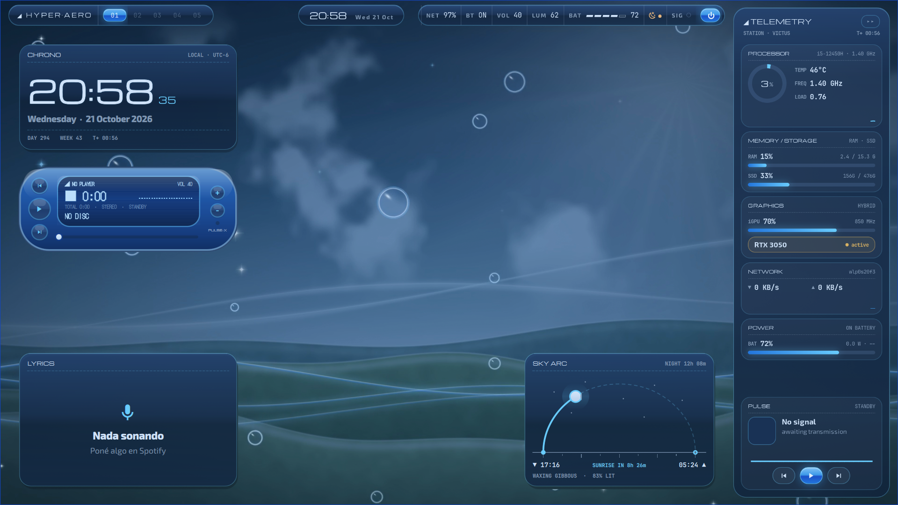

<div align="center">

# ◢ HYPER·AERO

**Un escritorio Frutiger Aero / Y2K para Hyprland en Arch Linux**

Vidrio brillante, burbujas, cielos animados y un centro de control con forma de teléfono: el futuro optimista de la computación del 2005, sobre un compositor Wayland moderno.

[English](README.md) · [Español](README.es.md)

-3d9be9?style=flat-square)


</div>



## Qué trae

| | |
|---|---|
| **Fondos animados** | Cuatro escenas originales en bucle (cielo, atardecer coral, laguna, cromo), cada una con versión de día y de noche |
| **Temas** | Acentos azul, rojo, verde y negro, modos claro y oscuro, y tus propios temas hechos en el **Estudio de temas** |
| **Ciclo día / noche** | Cambia de modo con la salida y la puesta del sol de tu zona, con una transición de vidrio |
| **Teléfono NEXUS** | Un centro de control con forma de teléfono (apps, Wi-Fi, Bluetooth, música, ajustes rápidos, pantalla «Hoy») con 8 pieles |
| **Widgets de escritorio** | 13 widgets que se pueden mover: reloj, reproductor, arco del sol y la luna, clima, sistema, pendientes, calendario, notas, visualizador, letras, GIF… |
| **TELEMETRY HUD** | Un panel lateral con CPU, RAM, GPU, red y batería |
| **Panel de pantallas** | Como el *Win + P* de Windows: solo laptop, duplicar, extender, solo monitor, y acomodar arrastrando; cambia solo al conectar o desconectar |
| **Perfiles de rendimiento** | *Completo*, *Equilibrado* y *Ligero*, se cambian cuando querás |
| **Extras** | Pantalla de bloqueo, protector de pantalla, alt-tab con vistas previas, vista de escritorios, capturas, grabación de pantalla, pantalla de inicio de sesión opcional |

El recorrido completo está en [Funciones](docs/es/FEATURES.md).

## Requisitos

|  | Mínimo | Recomendado |
|---|---|---|
| Sistema | Arch Linux (o basada en Arch con `pacman`) | Arch Linux al día |
| Hyprland | 0.56 (configuración en Lua) | la más reciente |
| CPU | 4 hilos | 8 hilos o más |
| RAM | 8 GB | 16 GB |
| GPU | cualquiera con drivers de Wayland funcionando | integrada Intel/AMD de los últimos ~6 años, o una dedicada |
| Disco | 1 GB libre | 2 GB libres |
| Perfil | *Ligero* | *Equilibrado* o *Completo* |

Detalles y consumo medido: [Rendimiento](docs/es/PERFORMANCE.md).

## Instalación

```bash
git clone https://github.com/jotaperom/hyper-aero.git
cd hyper-aero
./install.sh
```

El instalador revisa tu equipo y te recomienda un perfil, instala los paquetes (repos oficiales + AUR con `yay`/`paru`), **respalda tu configuración actual**, copia los archivos y descarga los fondos. Cerrá sesión y elegí **Hyprland** para arrancar.

Guía completa, opciones y pasos manuales: [Instalación](docs/es/INSTALL.md).

## Primeros pasos

| Teclas | Acción |
|---|---|
| `SUPER + F1` | Ver todos los atajos |
| `SUPER + R` | Teléfono NEXUS (apps) |
| `SUPER + Q` | Terminal |
| `SUPER + G` | Carrusel de temas |
| `SUPER + T` | Día / noche |
| `SUPER + P` | Pantallas |
| `SUPER + F2` | Perfil de rendimiento |

Todos los atajos: [Atajos](docs/es/KEYBINDS.md).

## Desinstalar

```bash
./uninstall.sh
```

Restaura el respaldo que se hizo al instalar. Ver [Instalación → Desinstalar](docs/es/INSTALL.md#desinstalar).

## Documentación

- [Instalación](docs/es/INSTALL.md)
- [Funciones](docs/es/FEATURES.md)
- [Atajos](docs/es/KEYBINDS.md)
- [Rendimiento y requisitos](docs/es/PERFORMANCE.md)
- [Personalizar](docs/es/CUSTOMIZING.md)
- [Solución de problemas](docs/es/TROUBLESHOOTING.md)

## Privacidad

HYPER·AERO no tiene telemetría ni funciones de IA. Solo se conecta a internet para:

- `ipapi.co`: una vez, al instalar, para sugerir tu ubicación para el ciclo día/noche (podés decir que no o escribirla vos).
- `wttr.in`: el clima de los widgets.
- `lrclib.net`: las letras de canciones del widget LYRICS, solo si lo tenés en el escritorio.
- GitHub: para descargar los fondos al instalar.

## Créditos

- Fuentes: [Exo 2](https://fonts.google.com/specimen/Exo+2) y [Michroma](https://fonts.google.com/specimen/Michroma), licencia SIL Open Font License (ver `assets/fonts`).
- Hecho sobre [Hyprland](https://hyprland.org), [Quickshell](https://quickshell.org), [eww](https://github.com/elkowar/eww), [Waybar](https://github.com/Alexays/Waybar), [mpvpaper](https://github.com/GhostNaN/mpvpaper), [swaync](https://github.com/ErikReider/SwayNotificationCenter), [rofi](https://github.com/davatorium/rofi), [kitty](https://sw.kovidgoyal.net/kitty/), [Starship](https://starship.rs) y [cava](https://github.com/karlstav/cava).
- Los fondos, los sonidos y el globo del teléfono se generan por procedimiento con los scripts de `tools/` y son parte de este proyecto.

## Licencia

[GPL-3.0](LICENSE)
