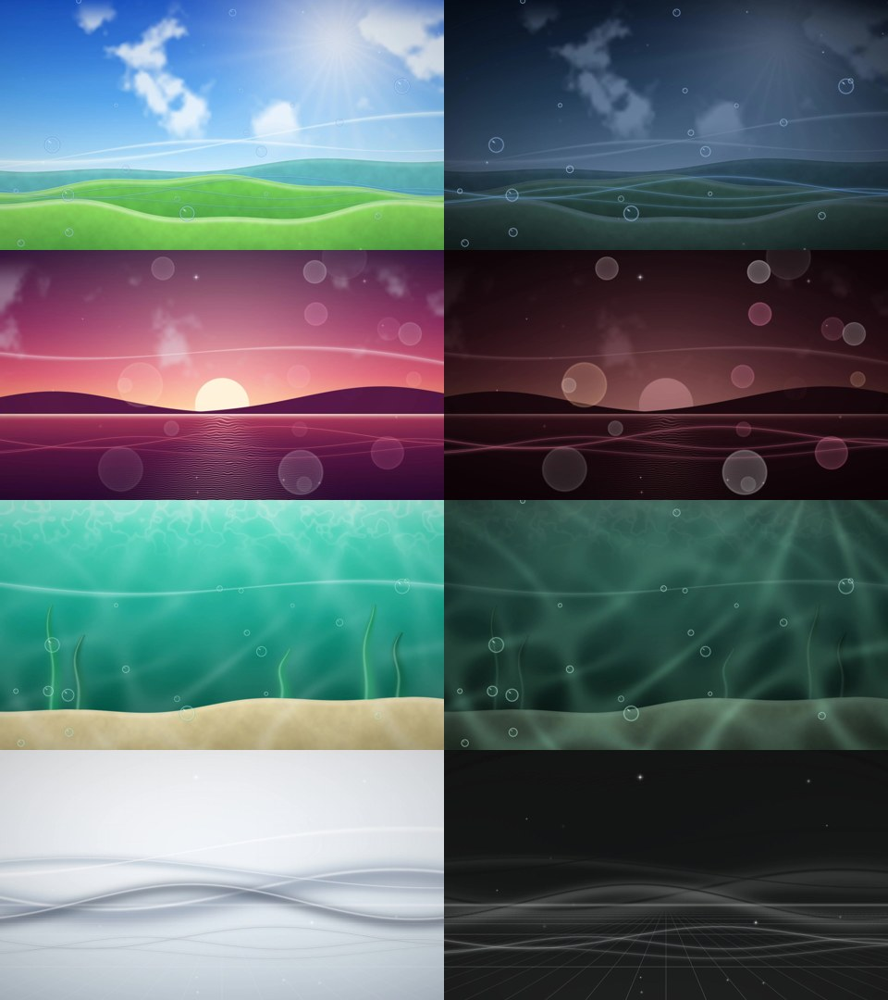

# Features

[← Back to README](../../README.md) · [Español](../es/FEATURES.md)

The interface is in English or Spanish (see [Customizing → Language](CUSTOMIZING.md#language)); the names below are the English ones.

## Themes and wallpapers

- **Four built-in themes**, each with its own animated wallpaper:
  - **Azul (blue)** — sky over green hills, bubbles and light waves.
  - **Rojo (red)** — coral sunset over the sea, bokeh lights.
  - **Verde (green)** — underwater lagoon, caustics and light rays.
  - **Negro (black)** — chrome waves; silver by day, a dark grid by night.
- **Day and night versions** of every theme. The whole desktop (bar, HUD, phone, terminal, notifications, GTK apps, rofi) follows the mode.
- **Theme Studio** (from the app launcher or the phone):
  - Pick any accent color; every component is re-tinted.
  - Turn any of your images into an animated wallpaper with layers: bubbles, waves, sparkles, bokeh, light rays, caustics, petals, stars, lens flare and grid.
  - Save your own themes. The preview shows your chosen wallpaper in every tab.
- **Theme carousel** (`SUPER + G`): swipe or use the arrows to switch themes; the wallpaper changes with the theme.
- **Glassy transitions** when the theme or the day/night mode changes (turned off in the *Lite* profile).

## Day / night — NIGHT DECK

- Automatic by default: switches at your local sunrise and sunset.
- `SUPER + ALT + T` — cancel any manual override and go back to automatic.
- `SUPER + T` — switch by hand; it stays that way until the next sunrise or sunset, then automatic mode takes over again.
- `SUPER + SHIFT + T` — warm light (blue-light filter via `hyprsunset`).
- The location is set during install. To change it: `aero-location LAT LON` (see [Customizing](CUSTOMIZING.md)).

## NEXUS phone

A phone-shaped control center that slides in from the side.

| Keys | Page |
|---|---|
| `SUPER + R` | Apps (search, favorites, run commands, switch windows — `CTRL + TAB` cycles them) |
| `SUPER + X` | Controls: volume, brightness, Wi-Fi, Bluetooth, night mode, warm light, do not disturb, power |
| `SUPER + W` | Wi-Fi |
| `SUPER + A` | Bluetooth |
| `SUPER + I` | Today: clock, greeting, weather, mini calendar, player, quick note |

Eight skins (iPhone, flip, Aqua, visor, slider, holo, PDA, orbit): open the controls page (`SUPER + X`) and tap **SKIN**. The **THEMES** button there opens the theme carousel.

## Desk widgets

`SUPER + D` shows or hides the widgets; `SUPER + ALT + D` opens the editor grid. Right-click a widget for its menu.

| Widget | What it does |
|---|---|
| CHRONO | Clock and date |
| PULSE-X | Media player (any MPRIS player: Spotify, browsers, mpv…) |
| SKY ARC | Sun and moon position for your location |
| ATMOS | Weather (wttr.in) |
| SYSTEM | CPU, RAM and disk |
| TASKS | To-do list |
| CALENDAR | Current month |
| NOTES | Quick note |
| SPECTRA | Audio visualizer (cava) |
| PILOT | Your user card |
| DOCK | App shortcuts |
| LYRICS | Synced lyrics for the current song (lrclib.net) |
| GIF | Any animated image |

Drag a window with `SUPER + left mouse` to the screen edge to send it to another desktop.

## TELEMETRY HUD

An eww panel with CPU (load, frequency, temperature), integrated and dedicated GPU (when present), RAM, disk, battery, network and uptime. `SUPER + H` switches between full and slim.

## Displays — `SUPER + P`

A Windows-style panel:

- **Laptop only**, **Duplicate**, **Extend**, **Monitor only**.
- Drag the screens to match where they physically are.
- Plugging or unplugging a monitor switches automatically.
- **Size on the laptop** and **size on the monitor**: 100 % to 200 % for each screen.

## Everyday tools

- **AEROBAR** (Waybar) — workspaces, clock, media, network, Bluetooth, battery. `SUPER + SHIFT + B` hides it.
- **SIGNAL** (swaync) — notification center, `SUPER + N`; do-not-disturb, `SUPER + SHIFT + N`.
- **AIRLOCK** (hyprlock) — lock screen, `SUPER + L`.
- **Screensaver** after 2 minutes idle, dim at 4, lock at 5 (hypridle).
- **ALT + TAB** with window previews; **SUPER + TAB** workspace overview.
- **Screenshots** to `~/Pictures/Screenshots` (or your localized Pictures folder): region `SUPER + SHIFT + S`, screen `Print`, window `SUPER + Print`.
- **Screen recording** (wf-recorder): `SUPER + ALT + R` full screen, `SUPER + ALT + SHIFT + R` region; press again to stop.
- **DECK terminal** (kitty) with a startup banner and a Starship prompt themed to match.
- **On-screen display** for volume and brightness keys.

## Optional

- **Login screen** (greetd + ReGreet) in the same style, with day and night versions: `./install.sh --with-login`.
- **Hybrid GPU session**: for laptops whose HDMI port is wired to the dedicated GPU. Adds an *HYPER·AERO* session that lets Hyprland use it when an external monitor is plugged in: `./install.sh --with-gpu-session`.
