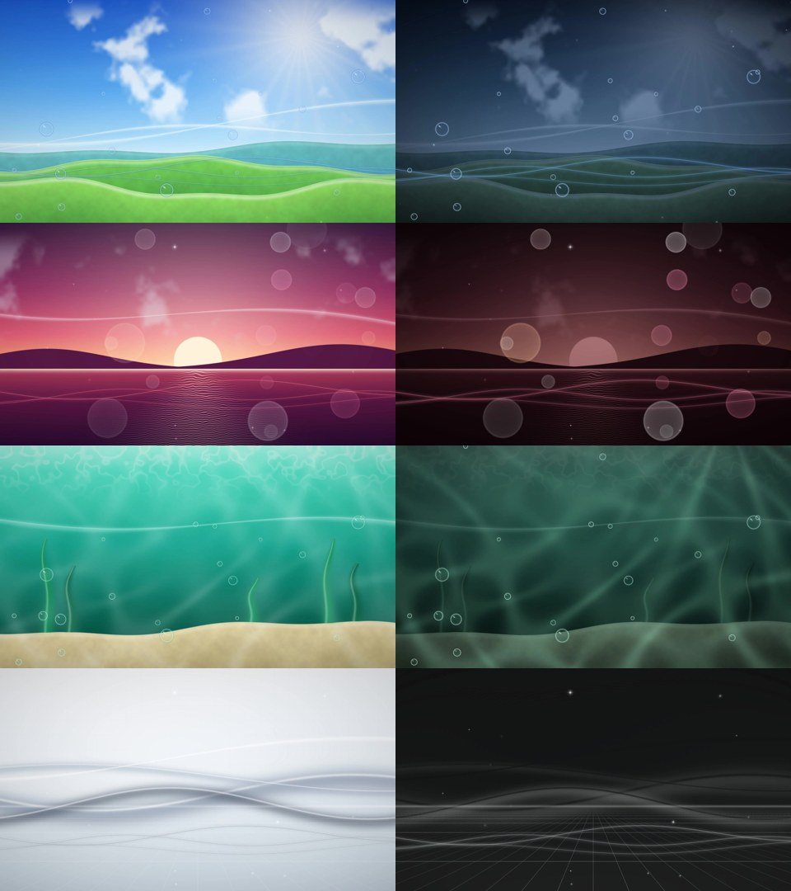

# Features

[← Back to README](../../README.md) · [Español](../es/FEATURES.md)

The interface is in English or Spanish (see [Customizing → Language](CUSTOMIZING.md#language)); the names below are the English ones.

## Themes and wallpapers

- **Four built-in themes**, each with its own animated wallpaper:
  - **Azul (blue)** — sky over green hills, bubbles and light waves.
  - **Rojo (red)** — coral sunset over the sea, bokeh lights.
  - **Verde (green)** — underwater lagoon, caustics and light rays.
  - **Negro (black)** — chrome waves; silver by day, a dark grid by night.
- **Day and night versions** of every theme. The whole desktop (bar, HUD, phone, terminal, notifications, GTK apps, rofi) follows the mode.
- **Theme Studio** (from the app launcher or the phone):
  - Pick any accent color; every component is re-tinted.
  - Turn any of your images into an animated wallpaper with layers: bubbles, waves, sparkles, bokeh, light rays, caustics, petals, stars, lens flare and grid.
  - Save your own themes. The preview shows your chosen wallpaper in every tab.
- **Theme carousel** (`SUPER + G`): swipe or use the arrows to switch themes; the wallpaper changes with the theme.
- **Glassy transitions** when the theme or the day/night mode changes (turned off in the *Lite* profile).

## Day / night — NIGHT DECK

- Automatic by default: switches at your local sunrise and sunset.
- `SUPER + ALT + T` — cancel any manual override and go back to automatic.
- `SUPER + T` — switch by hand; it stays that way until the next sunrise or sunset, then automatic mode takes over again.
- `SUPER + SHIFT + T` — warm light (blue-light filter via `hyprsunset`).
- The location is set during install. To change it: `aero-location LAT LON` (see [Customizing](CUSTOMIZING.md)).

## NEXUS phone

A phone-shaped control center that slides in from the side.

| Keys | Page |
|---|---|
| `SUPER + R` | Apps (search, favorites, run commands, switch windows — `CTRL + TAB` cycles them) |
| `SUPER + X` | Controls: volume, brightness, Wi-Fi, Bluetooth, night mode, warm light, do not disturb, power |
| `SUPER + W` | Wi-Fi |
| `SUPER + A` | Bluetooth |
| `SUPER + I` | Today: clock, greeting, weather, mini calendar, player, quick note |

Eight skins (iPhone, flip, Aqua, visor, slider, holo, PDA, orbit): open the controls page (`SUPER + X`) and tap **SKIN**. The **THEMES** button there opens the theme carousel.

## Desk widgets

`SUPER + D` shows or hides the widgets; `SUPER + ALT + D` opens the editor grid on the screen the mouse is on. Each monitor has its own independent set of widgets. Right-click a widget for its menu.

| Widget | What it does |
|---|---|
| CHRONO | Clock and date |
| PULSE-X | Media player (any MPRIS player: Spotify, browsers, mpv…) |
| SKY ARC | Sun and moon position for your location |
| ATMOS | Weather (wttr.in) |
| SYSTEM | CPU, RAM and disk |
| TASKS | To-do list |
| CALENDAR | Current month |
| NOTES | Quick note |
| SPECTRA | Audio visualizer (cava) |
| PILOT | Your user card |
| DOCK | App shortcuts |
| LYRICS | Synced lyrics for the current song (lrclib.net) |
| GIF | Any animated image |

Drag a window with `SUPER + left mouse` and hold it at the screen edge, or drop it on one of the desktop tiles at the top, to send it to another desktop. With several monitors, only the outer edges switch desktops; the edges between screens just move the window across. `SUPER + F` makes a window fullscreen.

### New in NEXUS (2.0)

- **Audio**: on the controls page, tap the arrow next to *Volume* (or right-click the volume on the bar). Pick the output and input device, set each one's volume, and set the volume of every app that is playing, KDE-style.
- **Dock**: press and hold an app and drag it to the dock; drag inside the dock to reorder, or out of it to remove. Right-click any app for *Pin to dock*.
- **Clipboard** (`SUPER + SHIFT + V`), **Emojis** (`SUPER + .`, search in English or Spanish) and **Color picker** (`SUPER + SHIFT + C`).

### Word-by-word lyrics

The LYRICS widget lights up each word as it is sung. When the lyrics include word timing it uses it; otherwise it spreads each line over its words by syllables, karaoke style.

## Aero effects

- **Music-reactive borders**: while something plays, the active window glows and a wave runs along its edges to the beat.
- **Aero Ripple**: water rings around the cursor on every click.
- **Aero Peek**: hover the bottom-right corner (or hold `SUPER + ,`) to see the desktop through glass outlines of your windows. Click the corner to show the desktop.
- **Aero Shake**: drag a window with `SUPER` and shake it to minimize the others; shake again to bring them back.
- **Flip 3D**: `SUPER + ALT + TAB` stacks your windows in 3D with live previews.
- **Radial menu**: `SUPER + Z` or `SUPER + middle click` opens a ring around the cursor with apps, screenshot, play/pause, next song, Bluetooth, audio, themes and settings.

## Weather on the desktop

Rain, drizzle, storms (with lightning), snow, fog and clouds drawn between the wallpaper and the widgets, following the real weather of your city. Drops slide down the glass when it rains.

## Control Panel and Welcome Center

`SUPER + O` opens a Vista-style Control Panel with every setting in one place. On the first start, the **Welcome Center** walks you through language, color, location and the key shortcuts.

## TELEMETRY HUD

An eww panel with CPU (load, frequency, temperature), integrated and dedicated GPU (when present), RAM, disk, battery, network and uptime. `SUPER + H` switches between full and slim.

## Displays — `SUPER + P`

A Windows-style panel:

- **Laptop only**, **Duplicate**, **Extend**, **Monitor only**.
- Drag the screens to match where they physically are.
- Plugging or unplugging a monitor switches automatically.
- **Size on the laptop** and **size on the monitor**: 100 % to 200 % for each screen.
- Monitors start at their best resolution and refresh rate, with a size picked from their real pixel density (a 27" 4K starts at 150 %, a 34" ultrawide at 100 %).
- **Desktops with several monitors** (no laptop): one size per screen, choose where TELEMETRY goes, swap left and right. Screens always touch each other, so the mouse moves freely between them.

## Everyday tools

- **AEROBAR** (Waybar) — workspaces, clock, media, network, Bluetooth, battery. `SUPER + SHIFT + B` hides it.
- **SIGNAL** (swaync) — notification center, `SUPER + N`; do-not-disturb, `SUPER + SHIFT + N`.
- **AIRLOCK** (hyprlock) — lock screen, `SUPER + L`.
- **Screensaver** after 2 minutes idle, dim at 4, lock at 5 (hypridle).
- **ALT + TAB** with window previews; **SUPER + TAB** workspace overview.
- **Screenshots** to `~/Pictures/Screenshots` (or your localized Pictures folder): region `SUPER + SHIFT + S`, screen `Print`, window `SUPER + Print`.
- **Screen recording** (wf-recorder): `SUPER + ALT + R` full screen, `SUPER + ALT + SHIFT + R` region; press again to stop.
- **DECK terminal** (kitty) with a startup banner and a Starship prompt themed to match.
- **On-screen display** for volume and brightness keys.

## Optional

- **Login screen** (greetd + ReGreet) in the same style, with day and night versions: `./install.sh --with-login`.
- **Hybrid GPU session**: for laptops whose HDMI port is wired to the dedicated GPU. Adds an *HYPER·AERO* session that lets Hyprland use it when an external monitor is plugged in: `./install.sh --with-gpu-session`.
